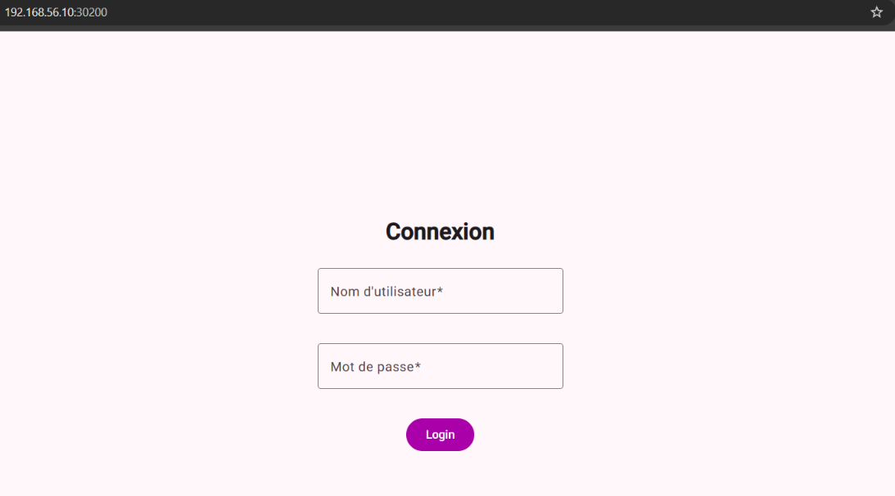
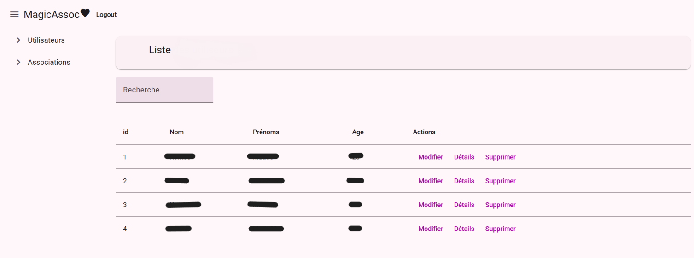
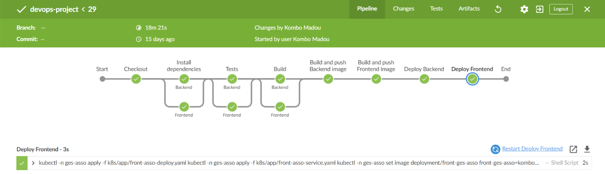
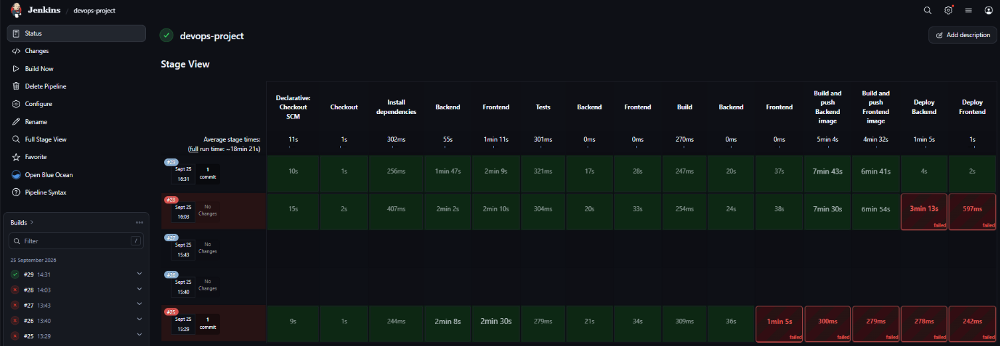
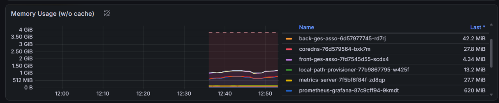
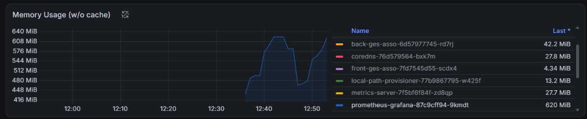

# Projet DevOps

Ce projet met en place une plateforme DevOps en local : création de machines virtuelles, déploiement d’un cluster Kubernetes, automatisation avec Ansible, intégration et déploiement continus avec Jenkins, et supervision avec Prometheus et Grafana.

L’environnement repose sur deux machines virtuelles Debian, sur lesquelles tourne un cluster k3s. Une application web Angular/NestJS y est conteneurisée et déployée. Jenkins construit et publie les images Docker, et la supervision du cluster et des workloads repose sur la stack `kube-prometheus-stack`.

## Objectifs du projet

- Disposer d’un environnement local reproductible avec Vagrant et VirtualBox.
- Déployer un cluster Kubernetes léger avec k3s, avec un nœud control-plane et un nœud worker.
- Conteneuriser une application Angular/NestJS avec Docker.
- Mettre en place un pipeline CI/CD avec Jenkins et Kaniko.
- Automatiser l’installation et la configuration de l’infrastructure avec Ansible.
- Superviser le cluster, les nœuds et les pods avec Prometheus et Grafana.
- Documenter les problèmes rencontrés et les solutions trouvées.

## Architecture

```text
Machine hôte Windows
        |
        | Vagrant + VirtualBox
        |
+---------------------+        +---------------------+
|     k3s-master      |        |     k3s-worker      |
|  192.168.56.10      |        |  192.168.56.11      |
|---------------------|        |---------------------|
|  k3s server         |<------>|  k3s agent          |
|  Control plane      |        |  Worker node        |
|  Jenkins            |        |                     |
|  Prometheus         |        |                     |
|  Grafana            |        |                     |
+---------------------+        +---------------------+
```

Les deux VMs ont un réseau NAT pour accéder à Internet et un réseau privé Host-Only pour communiquer entre elles et avec la machine hôte. Le nœud `k3s-master` héberge le control plane k3s, ainsi que la CI/CD et le monitoring. Le nœud `k3s-worker` exécute les workloads.

## Stack technique

| Outil | Rôle dans le projet |
|---|---|
| VirtualBox | Virtualisation des machines virtuelles |
| Vagrant | Provisionnement et gestion des VMs Debian |
| Debian | Système d’exploitation des nœuds |
| k3s | Distribution Kubernetes légère |
| kubectl | Administration du cluster Kubernetes |
| Helm | Déploiement de Jenkins et du monitoring |
| Docker | Conteneurisation de l’application |
| Kaniko | Construction des images Docker dans Kubernetes |
| Jenkins | Automatisation des pipelines CI/CD |
| Ansible | Automatisation de la configuration et du déploiement |
| Prometheus | Collecte et stockage des métriques |
| Grafana | Visualisation des métriques |
| Angular / NestJS | Application web frontend et backend |

## Structure du dépôt

```text
.
├── app/                  # Application Angular (frontend) et NestJS (backend), avec captures d’écran
│   └── screenshots/      # Captures de l’application déployée
├── infra/                # Vagrantfile et configuration des VMs
├── k8s/                  # Manifests Kubernetes et fichiers Helm
│   ├── app/              # Deployments et Services de l’application
│   ├── jenkins/          # Configuration Jenkins
│   └── monitoring/       # Configuration Prometheus et Grafana
├── jenkins/              # Documentation liée à Jenkins
│   └── screenshots/      # Captures du pipeline Jenkins
├── ansible/              # Inventaire, playbooks et rôles Ansible
├── monitoring/           # Dashboards Grafana et captures d’écran
├── Jenkinsfile           # Pipeline Jenkins principal
├── Jenkinsfile.complete  # Pipeline Jenkins principal (avec le manifest des agents mis en évidence)
├── Jenkinsfile.backend   # Pipeline du backend NestJS
├── Jenkinsfile.frontend  # Pipeline du frontend Angular
├── TROUBLESHOOTING.md    # Problèmes rencontrés et solutions, classés par domaine
└── README.md
```

## Prérequis

Pour démarrer le projet, il faut avoir :

- Windows 10/11 comme machine hôte
- VirtualBox
- Vagrant
- Un terminal avec OpenSSH
- WSL pour l’utilisation d’Ansible comme nœud de contrôle (ou d'une troisième vm linux)
- kubectl et Helm pour administrer le cluster
- Un compte Docker Hub pour la publication des images

Les VMs sont configurées avec les adresses suivantes :

```text
k3s-master : 192.168.56.10
k3s-worker : 192.168.56.11
```

## Mise en place de l’infrastructure

Les machines virtuelles sont définies dans le dossier `infra/` avec un `Vagrantfile`. Elles avaient au départ 2 Go de RAM et 2 vCPU. Les ressources du master ont ensuite été augmentées à 4 Go de RAM et 5 vCPU pour faire tourner Jenkins, Prometheus et Grafana dans le cluster k3s.

```bash
cd infra
vagrant up
vagrant ssh k3s-master
vagrant ssh k3s-worker
```

Il est préférable de passer par Vagrant pour la connexion SSH, car il utilise automatiquement les clés générées pour chaque machine :

```bash
vagrant ssh k3s-master
vagrant ssh k3s-worker
```

## Déploiement du cluster k3s

Le control plane s’installe sur `k3s-master`, en forçant l’adresse du réseau privé :

```bash
curl -sfL https://get.k3s.io | \
  sh -s - server \
  --node-ip 192.168.56.10 \
  --advertise-address 192.168.56.10
```

Le token du cluster se récupère ensuite sur le master, pour que le worker puisse rejoindre le cluster :

```bash
sudo cat /var/lib/rancher/k3s/server/node-token
```

Sur `k3s-worker`, l’agent k3s s’installe avec l’adresse du serveur, le token et l’IP privée du worker :

```bash
curl -sfL https://get.k3s.io | \
  K3S_URL=https://192.168.56.10:6443 \
  K3S_TOKEN=<TOKEN> \
  sh -s - agent
```

La configuration du réseau est un point clé du projet. Sans l’option `--node-ip`, k3s peut utiliser l’adresse NAT VirtualBox `10.0.2.15`, qui est la même sur les deux VMs, et les nœuds ne communiquent plus correctement.

Vérification du cluster :

```bash
kubectl get nodes -o wide
```

Résultat attendu :

```text
NAME          STATUS   ROLES                  INTERNAL-IP
k3s-master    Ready    control-plane,master   192.168.56.10
k3s-worker    Ready    <none>                 192.168.56.11
```

## Déploiement de l’application

L’application se compose d’un frontend Angular et d’un backend NestJS. Chacun a son propre `Dockerfile`, donc les images sont construites séparément.

Les manifests Kubernetes correspondants se trouvent dans `k8s/app/` :

```text
k8s/app/
├── back-asso-deploy.yaml
├── back-asso-service.yaml
├── front-asso-deploy.yaml
└── front-asso-service.yaml
```

Ils servent à déployer les pods, à exposer les services et à rendre l’application accessible depuis le cluster.

Une fois déployée par le pipeline, l’application est accessible depuis la machine hôte.



*Page de connexion de l’application.*



*Liste des utilisateurs, servie par le backend NestJS déployé sur le cluster.*

## Pipeline CI/CD avec Jenkins

Jenkins est déployé dans le cluster Kubernetes avec le chart Helm officiel. Il est exposé via un `NodePort` pour être accessible depuis la machine hôte :

```text
http://192.168.56.10:30080
```

La configuration personnalisée de Jenkins comprend :

- Un namespace `jenkins` dédié
- Un `ServiceAccount` et des règles RBAC pour interagir avec le cluster
- Un volume persistant pour garder les données de Jenkins
- Une exposition en `NodePort` sur le port `30080`
- Des agents Kubernetes pour exécuter les builds

Les pipelines Jenkins sont écrits dans des `Jenkinsfile` :

- `Jenkinsfile.backend` pour construire le backend NestJS
- `Jenkinsfile.frontend` pour construire le frontend Angular
- `Jenkinsfile.complete` pour une chaîne complète de build et de déploiement

Le pipeline complet enchaîne les étapes suivantes :

1. Récupération du code depuis Git
2. Installation des dépendances du backend et du frontend
3. Exécution des tests
4. Build des applications
5. Construction et publication des images Docker avec Kaniko
6. Déploiement du backend et du frontend dans le namespace `ges-asso`
7. Mise à jour des images utilisées par les Deployments Kubernetes



*Vue du pipeline : toutes les étapes sont réussies.*



*Durée de chaque étape et durée totale du pipeline, inférieure à 20 minutes.*

Les images sont construites dans le cluster avec Kaniko. Cela évite d’exposer le Docker daemon de la VM ou d’installer Docker dans les agents Jenkins. Les images sont ensuite publiées sur Docker Hub.

## Supervision avec Prometheus et Grafana

La supervision est déployée avec le chart Helm `kube-prometheus-stack`, qui installe entre autres Prometheus, Grafana, Alertmanager, `kube-state-metrics` et Node Exporter.

```bash
helm repo add prometheus-community https://prometheus-community.github.io/helm-charts
helm repo update

helm install prometheus prometheus-community/kube-prometheus-stack \
  --namespace monitoring \
  --create-namespace \
  -f k8s/monitoring/prometheus-grafana-values.yaml
```

Grafana est exposé via un `NodePort` :

```text
http://192.168.56.10:30030
```

Les dashboards par défaut permettent de suivre :

- L’état global du cluster
- La consommation CPU et mémoire des nœuds
- Les ressources utilisées par les pods et les namespaces
- Les métriques système collectées par Node Exporter



*Consommation mémoire des pods du cluster.*



*Évolution de la consommation mémoire du pod Grafana dans le temps.*

Prometheus peut être consulté ponctuellement avec un port-forward :

```bash
kubectl port-forward \
  --address 0.0.0.0 \
  -n monitoring \
  svc/prometheus-kube-prometheus-prometheus \
  9090:9090
```

Puis ouvrir :

```text
http://192.168.56.10:9090
```

## Automatisation avec Ansible

Ansible est utilisé depuis WSL, qui sert de nœud de contrôle. Il se connecte en SSH aux deux VMs pour automatiser leur préparation, l’installation de k3s et de Helm, et le déploiement des composants.

L’organisation sépare l’inventaire, les variables, les playbooks et les rôles :

```text
ansible/
├── ansible.cfg
├── inventories/
│   └── local/
├── playbooks/
│   └── site.yml
└── roles/
    ├── common/
    ├── k3s_prerequisites/
    ├── k3s_server/
    ├── k3s_agent/
    ├── helm/
    ├── jenkins/
    ├── monitoring/
    └── cluster_validation/
```

Le playbook principal est `ansible/playbooks/site.yml`. Il applique les rôles dans cet ordre :

```text
common
→ k3s_prerequisites
→ k3s_server
→ k3s_agent
→ helm
→ jenkins
→ monitoring
→ cluster_validation
```

Les secrets, comme le token k3s ou les identifiants Docker Hub, sont prévus dans un fichier chiffré avec Ansible Vault et ne doivent jamais être versionnés en clair.

Lancement du playbook :

```bash
cd ansible
ansible-playbook playbooks/site.yml
```

Vérification de la connectivité :

```bash
ansible all -m ansible.builtin.ping
```

## Problèmes rencontrés

Quelques problèmes sont apparus pendant le projet, surtout autour du réseau, du DNS et de la gestion des ressources Kubernetes.

Les plus marquants sont résumés ci-dessous. Le détail complet de chaque problème (symptôme, cause et solution) se trouve dans [TROUBLESHOOTING.md](TROUBLESHOOTING.md).

### Adresses IP identiques sur les nœuds

Au départ, les deux VMs utilisaient l’adresse NAT `10.0.2.15`. Comme elle est la même sur les deux machines, le control plane n’arrivait pas à joindre le kubelet du worker.

La solution consiste à forcer les IP du réseau privé avec `--node-ip` sur le master et `node-ip` dans la configuration de l’agent sur le worker.

### Résolution DNS défaillante

Les pods avaient des erreurs `ErrImagePull` ou `ImagePullBackOff`, car ils n’arrivaient pas à résoudre `registry-1.docker.io`. Le problème venait de la configuration DNS des VMs, pas des images.

La correction consiste à utiliser des serveurs DNS publics, puis à vérifier la résolution depuis un pod :

```bash
kubectl run test-net \
  --image=busybox \
  --rm -it \
  --restart=Never \
  -- nslookup registry-1.docker.io
```

### CoreDNS et monitoring

Grafana n’arrivait pas à joindre le service Prometheus à cause d’un blocage du plugin Kubernetes de CoreDNS. Redémarrer le déploiement CoreDNS rétablit la résolution DNS interne :

```bash
kubectl rollout restart deployment/coredns -n kube-system
```

### Décalage horaire des VMs

Prometheus affichait des métriques incohérentes à cause d’un gros décalage de l’horloge système. La synchronisation se corrige avec Chrony :

```bash
sudo chronyc makestep
```

## Compétences mises en pratique

- Création d’un environnement multi-VM avec Vagrant et VirtualBox
- Administration d’un cluster Kubernetes k3s
- Écriture et application de manifests Kubernetes
- Conteneurisation d’une application frontend et backend
- Mise en place d’un pipeline CI/CD avec Jenkins
- Construction d’images dans Kubernetes avec Kaniko
- Automatisation de l’infrastructure avec Ansible
- Supervision d’un cluster avec Prometheus et Grafana
- Diagnostic de problèmes de réseau, de DNS, de stockage et de synchronisation de l’heure
- Documentation technique et retour d’expérience

## Améliorations possibles

- Ajouter un Ingress Controller avec HTTPS
- Mettre en place GitOps avec Argo CD
- Utiliser un stockage distribué comme Longhorn
- Ajouter des alertes Prometheus vers un canal de notification
- Intégrer les tests Ansible avec Molecule et ansible-lint
- Étendre l’infrastructure avec Terraform vers un environnement cloud

## Captures d’écran

Les captures de l’application, du pipeline Jenkins et de Grafana sont intégrées dans leurs sections respectives. Les fichiers se trouvent dans `app/screenshots/`, `jenkins/screenshots/` et `monitoring/screenshots/`.